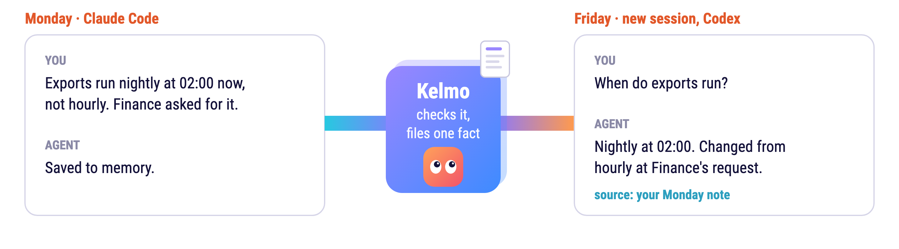
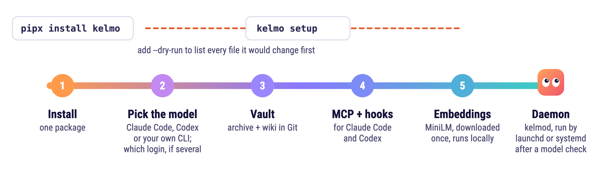
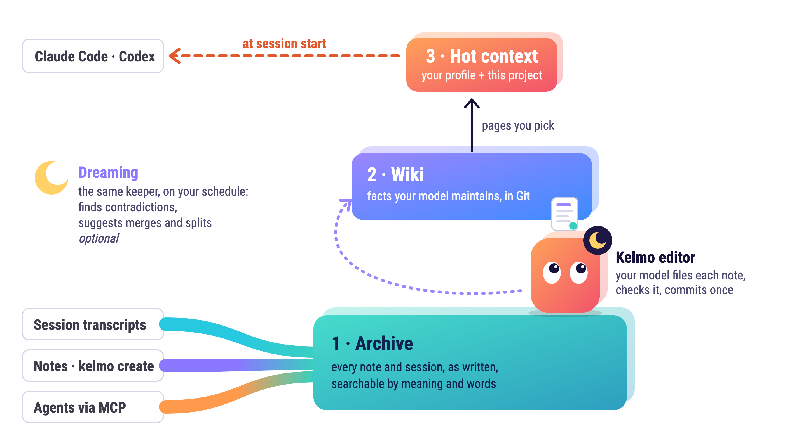
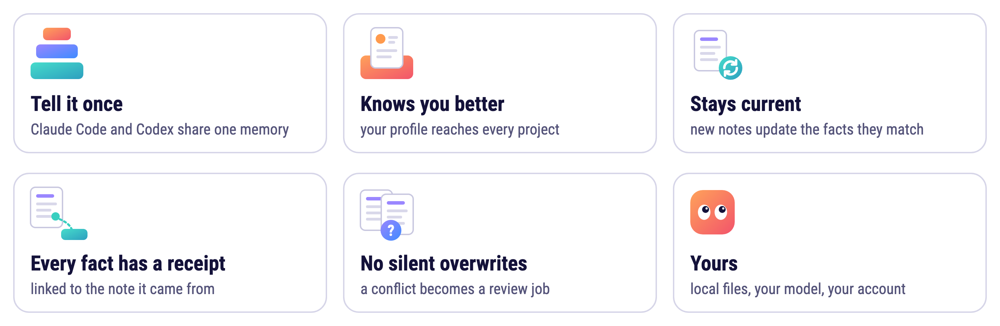
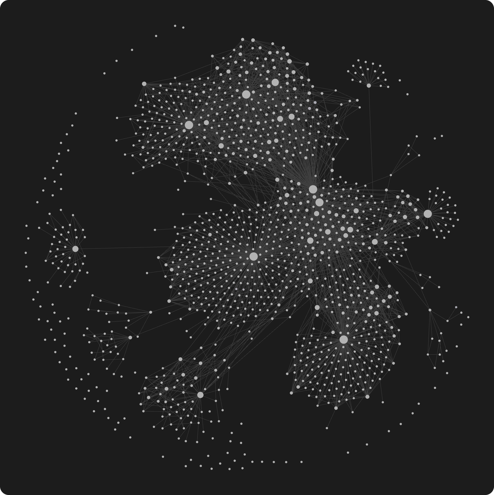
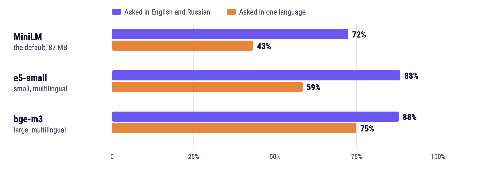
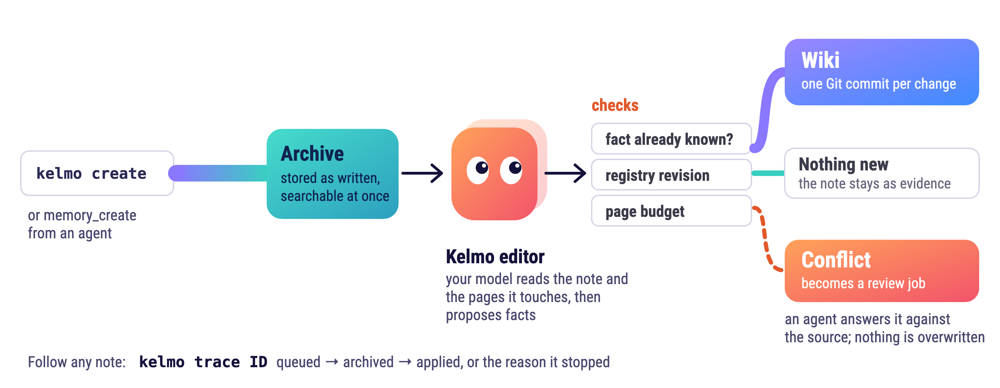

<h1 align="center">Kelmo</h1>

<p align="center"><strong>Long-term memory for coding agents. Tell it once, and Claude Code and Codex remember.</strong></p>

<p align="center">
  <a href="https://pypi.org/project/kelmo/"></a>
  <a href="https://github.com/dazaronak/kelmo/actions/workflows/ci.yml"></a>
  <a href="https://github.com/dazaronak/kelmo/blob/main/LICENSE"></a>
  
</p>

<p align="center">
  <picture>
    <source media="(prefers-color-scheme: dark)" srcset="https://raw.githubusercontent.com/dazaronak/kelmo/main/docs/assets/kelmo-tell-once-dark.png">
    
  </picture>
</p>

Kelmo stores your notes and sessions in a local archive. A model you choose files them into a
small wiki in Git, and your agent gets the pages that matter when a session starts.

## Install

You need macOS on Apple Silicon or Linux (x86_64 or aarch64), Python 3.12 or 3.13, Git with an author name and email, and Claude Code or
Codex logged in. You can also put your own program, including a local model, behind the
[executor protocol](https://github.com/dazaronak/kelmo/blob/main/docs/EXECUTORS.md).

```sh
pipx install kelmo        # or: uv tool install kelmo
cd your-repository
kelmo setup --disable-native-memory --project my-app --link "$PWD" --dry-run   # shows the plan, no model calls
kelmo setup --disable-native-memory --project my-app --link "$PWD"
```

Some Python builds on macOS have no SQLite extension support, which Kelmo needs. If Kelmo reports that,
reinstall it with `uv tool install --managed-python --python 3.13 kelmo`.

Setup finds your clients, suggests a model and asks which login to use. `--disable-native-memory`
tells the agent to use Kelmo instead of the client's built-in memory, so the two do not compete.
Changed files get verified backups, and [removal](https://github.com/dazaronak/kelmo/blob/main/docs/REMOVAL.md) starts with a preview.
Session capture is off unless you add `--session-memory auto`.

Prefer to hand it over? Tell your agent:
`Read https://raw.githubusercontent.com/dazaronak/kelmo/main/INSTALL_FOR_AGENTS.md and install Kelmo for me.`

<p align="center">
  <picture>
    <source media="(prefers-color-scheme: dark)" srcset="https://raw.githubusercontent.com/dazaronak/kelmo/main/docs/assets/kelmo-install-dark.png">
    
  </picture>
</p>

**See it work.** Tell Kelmo one thing:

```sh
kelmo create --project my-app --text 'Exports run nightly at 02:00, not hourly.' --wait
kelmo pages
```

Restart your agent, open a new session in that repository and ask when exports run. Codex first asks
you to trust the new hooks in `/hooks`. Follow any note with `kelmo trace OPERATION_ID`.

## How it works

<p align="center">
  <picture>
    <source media="(prefers-color-scheme: dark)" srcset="https://raw.githubusercontent.com/dazaronak/kelmo/main/docs/assets/kelmo-layers-dark.png">
    
  </picture>
</p>

<p align="center">
  <picture>
    <source media="(prefers-color-scheme: dark)" srcset="https://raw.githubusercontent.com/dazaronak/kelmo/main/docs/assets/kelmo-features-dark.png">
    
  </picture>
</p>

- **Archive.** Every note and transcript you give it, unchanged, searchable by meaning and by words.
- **Wiki.** Markdown pages in Git: a map for each project plus topic pages. A new note updates the
  fact it matches instead of adding a duplicate, and each change is one commit.
- **Hot context.** Your shared pages and the current project's hub reach the agent at session start.
  Link a repository with [`kelmo link`](https://github.com/dazaronak/kelmo/blob/main/docs/HUBS.md) and its worktrees get the same hub. When
  something changes, the open session gets it on the next prompt; a hub that was fully delivered and has
  not changed is not sent again in that session. Claude Code accepts at most 10,000 characters from a hook, so a larger hub arrives as an
  excerpt with a pointer ([details](https://github.com/dazaronak/kelmo/blob/main/docs/HOT.md)).

Everything runs locally under your account. Apart from the one-time embedding model download, network
traffic comes from the model CLI you choose, or from a shared server if you set one up.

The wiki is plain Markdown with wikilinks, so Obsidian can open it. Browse it there and leave the editing
to Kelmo: a hand edit holds back publishing until you restore the page.

<p align="center">
  
</p>
<p align="center"><sub>My own wiki in Obsidian's graph view. A real screenshot, not a demo dataset: each dot is a page, each line a link.</sub></p>

## Ask in either language

If your notes mix two languages, asking in both helped every model measured here. The agent's
`memory_search` tool takes the same question in English and in Russian, and Kelmo merges both
result lists. Russian is the only second language so far.

<p align="center">
  <picture>
    <source media="(prefers-color-scheme: dark)" srcset="https://raw.githubusercontent.com/dazaronak/kelmo/main/docs/assets/kelmo-search-dark.png">
    
  </picture>
</p>

The chart shows how often the right note was in the top 5, over 398 questions on one private vault of
9,530 text chunks. "One language" includes asking in one language about a note written in the other:
with MiniLM, a question in the note's own language finds it 70% of the time, and a question in the other
language 17%. A model wrote the questions after reading the notes, so expect lower numbers on your own.

MiniLM is the default because it is an 87 MB download and needs no GPU. e5-small and bge-m3 run behind
an embedding broker. [docs/MODELS.md](https://github.com/dazaronak/kelmo/blob/main/docs/MODELS.md) has the full results, memory, speed and setup.

## What the background editor buys you

Every note goes through the model you choose, billed to that CLI's subscription or API key. On the
author's vault, from November 1 to 8, 2026, the editor processed 390 notes for $61.47 on an API key with
Claude Haiku 5.5: a median of 13 cents and two model calls per note. A subscription counts the calls
against its limits instead. A lighter vault costs less.

<p align="center">
  <picture>
    <source media="(prefers-color-scheme: dark)" srcset="https://raw.githubusercontent.com/dazaronak/kelmo/main/docs/assets/kelmo-editor-dark.png">
    
  </picture>
</p>

The model reads each note against the facts already stored, so a new note can update the old fact
instead of sitting next to it. About half of the notes on that vault (714 of 1,417) changed no page.
They stayed in the archive as evidence, which keeps the pages small. Each fact cites the archived note
behind its latest version, and Git keeps every earlier version. The vault holds 6,361 archived records
and 8,720 facts on 1,249 pages.

## Known issues

The editor makes mistakes. An audit of the wiki layer on the author's vault found wrong text in 5 of 347
facts (1.4%) and flagged 36 of 381 as overtaken by a newer note (9.4%).

Each layer is affected differently. The archive keeps every note as written, with its date, so the newer
note is still there. Search does not rank newer notes higher, so Kelmo relies on the agent to search the
archive and compare dates. Hot context is built from wiki pages and carries the same lag until the wiki
catches up.

The fixes are tracked in [GitHub issues](https://github.com/dazaronak/kelmo/issues). They will come with a
clean-up command that re-checks an existing wiki against the archive and brings it up to date. Nothing is
lost in the meantime, because every note stays in the archive.

## How a note becomes a fact

<p align="center">
  <picture>
    <source media="(prefers-color-scheme: dark)" srcset="https://raw.githubusercontent.com/dazaronak/kelmo/main/docs/assets/kelmo-note-path-dark.png">
    
  </picture>
</p>

- Only the editor writes the wiki, through a registry of pages and facts. A hand edit to a registered
  page blocks the next publication until it is restored.
- A model proposes changes. Kelmo checks them against the registry, the page budget and the source
  before it commits anything.
- A conflict is never overwritten silently. It becomes a
  [resolution job](https://github.com/dazaronak/kelmo/blob/main/docs/RESOLUTION.md) that an agent answers against the archived source.

The registry guarantees that pages match their records. It cannot prove the model understood the note,
which is why the editor's output was audited (see [Known issues](#known-issues)).

## Documentation

- **Get started:** [setup and options](https://github.com/dazaronak/kelmo/blob/main/docs/SETUP.md), [everyday commands](https://github.com/dazaronak/kelmo/blob/main/docs/USAGE.md),
  [CLI reference](https://github.com/dazaronak/kelmo/blob/main/docs/CLI.md), [removal](https://github.com/dazaronak/kelmo/blob/main/docs/REMOVAL.md)
- **Memory:** [project hubs](https://github.com/dazaronak/kelmo/blob/main/docs/HUBS.md), [hot context](https://github.com/dazaronak/kelmo/blob/main/docs/HOT.md),
  [notes](https://github.com/dazaronak/kelmo/blob/main/docs/NOTE-CONTRACT.md), [sessions](https://github.com/dazaronak/kelmo/blob/main/docs/SESSIONS.md), [Dreaming](https://github.com/dazaronak/kelmo/blob/main/docs/DREAMING.md),
  [conflicts](https://github.com/dazaronak/kelmo/blob/main/docs/RESOLUTION.md), [work state](https://github.com/dazaronak/kelmo/blob/main/docs/ACTIONS.md), [graph](https://github.com/dazaronak/kelmo/blob/main/docs/GRAPH.md)
- **Models:** [embeddings](https://github.com/dazaronak/kelmo/blob/main/docs/MODELS.md), [embedding broker](https://github.com/dazaronak/kelmo/blob/main/docs/EMBEDDING-BROKER.md),
  [executors](https://github.com/dazaronak/kelmo/blob/main/docs/EXECUTORS.md), [executor accounts](https://github.com/dazaronak/kelmo/blob/main/docs/EXECUTOR-ACCOUNT.md)
- **Operations:** [daemon](https://github.com/dazaronak/kelmo/blob/main/docs/DAEMON.md), [diagnostics](https://github.com/dazaronak/kelmo/blob/main/docs/DIAGNOSTICS.md),
  [shared server](https://github.com/dazaronak/kelmo/blob/main/docs/SERVER-OPERATIONS.md), [shared client](https://github.com/dazaronak/kelmo/blob/main/docs/EDGE.md), [SSH gate](https://github.com/dazaronak/kelmo/blob/main/docs/SSH-GATE.md),
  [knowledge sync](https://github.com/dazaronak/kelmo/blob/main/docs/KNOWLEDGE-SYNC.md),
  [migration](https://github.com/dazaronak/kelmo/blob/main/docs/MIGRATION-CLI.md), [adoption](https://github.com/dazaronak/kelmo/blob/main/docs/ADOPTION-CONTRACT.md)
- **Internals:** [architecture](https://github.com/dazaronak/kelmo/blob/main/docs/ARCHITECTURE.md), [technical design](https://github.com/dazaronak/kelmo/blob/main/docs/TECHNICAL.md), [wiki file contract](https://github.com/dazaronak/kelmo/blob/main/docs/WIKI-FILE-CONTRACT.md),
  [runtime isolation](https://github.com/dazaronak/kelmo/blob/main/docs/RUNTIME-SECURITY.md), [tests and CI](https://github.com/dazaronak/kelmo/blob/main/docs/CI.md),
  [target state](https://github.com/dazaronak/kelmo/blob/main/docs/TARGET-STATE.md), [releasing](https://github.com/dazaronak/kelmo/blob/main/docs/RELEASING.md)

## License

Apache-2.0. See [LICENSE](https://github.com/dazaronak/kelmo/blob/main/LICENSE).
