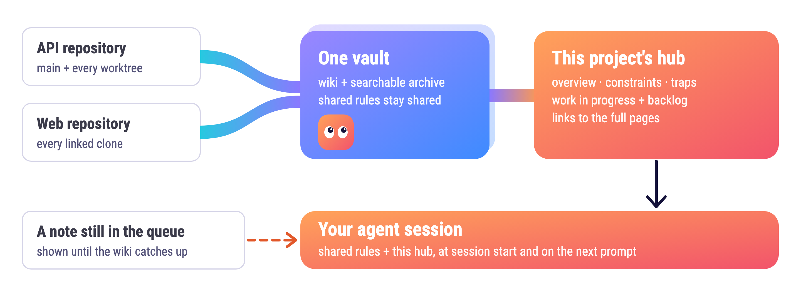
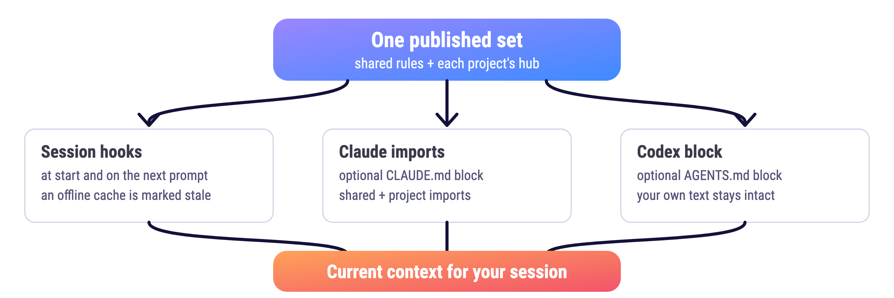

# Project hubs

One vault holds the archive and wiki for many repositories. Each project has a generated hub containing its map, constraints, known traps, WIP and Backlog. Work rows link to their source pages; the full wiki remains the source of detail. Mandatory pages precede the hub in session context.

<p align="center">
  <picture>
    <source media="(prefers-color-scheme: dark)" srcset="assets/kelmo-hubs-dark.png">
    
  </picture>
</p>

## Manage projects

Use `kelmo project add NAME` to open a hub, `kelmo project rename OLD NEW` to rename it, and `kelmo projects` to inspect projects and links. `kelmo link --project NAME [DIR]` opens a missing hub and associates a Git repository with the project; `kelmo unlink [--project NAME] [DIR]` detaches it without deleting the hub. Git common-directory selection covers sibling worktrees. Conflicting repository or remote bindings are errors.

Unlink records `excluded_common_dirs` on that project, so its remote or root fallback cannot select the detached clone again. Other clones and independent project mappings remain active. Link to the same project clears the exclusion. Sibling worktrees share the same exclusion. If a detached repository moves, run unlink at the new location to keep it detached.

These commands update the selected vault's configuration and may publish generated wiki files. Backups and publication details are returned by the command. Inspect the output and run `kelmo doctor --vault VAULT` after changes. Use `--vault VAULT` to select a non-default vault.

## Choose delivery

Hooks deliver context at session start and can refresh it on the next prompt. Embedding is optional and changes instruction files only when explicitly requested. Set `--current` to the directory containing the generated views if it differs from the vault's `knowledge/hot` directory. A session in a directory no project is linked to receives the mandatory pages and a one-line notice naming `kelmo projects --json` and `kelmo link --project NAME`, not an empty block.

For Claude, print the import lines first:

```sh
kelmo hub import --project NAME --scope global
kelmo hub import --project NAME --scope project
```

To write them, add `--file /path/to/CLAUDE.md` to each command. The global file gets the mandatory import and the repository file gets the project import. The two reads can briefly see different generations during a switch. For a single-generation read, use `kelmo hub import --project NAME --strict --file /path/to/repo/CLAUDE.md`; it imports the combined `NAME.full.md` instead.

For Codex, `kelmo hub embed --codex --project NAME --file /path/to/repo/AGENTS.md` copies the combined view into an owned block. Without `--file`, it uses `AGENTS.md` in the current directory. It preserves bytes outside the block, verifies a backup before changing an existing file, and refuses symlink paths. Do not use it on an AGENTS.md managed through a symlink; integrate the generated view in that compiler instead. The choice is recorded in the vault's state directory in `hub-embed.json`. SessionStart and UserPromptSubmit update the selected block when the bundle changes; the Claude hooks refresh a Codex block embedded in the same repository too, because Claude Code also reads `AGENTS.md`. The hook also injects the change on that turn. SessionStart always delivers the bundle. On later prompts, unchanged verified imports or blocks suppress repeated delivery; without any instruction-file integration the session's own delivery record does, and an unchanged bundle becomes a one-line marker naming the generation and where to read it. A change to the pending list alone delivers the pending block, not the whole hub. Missing, altered or stale imports cannot suppress current memory. A prompt the client blocked or a rewind can lose a delivered change; the marker names the generation so the agent can tell, and a restart delivers everything again.

<p align="center">
  <picture>
    <source media="(prefers-color-scheme: dark)" srcset="assets/kelmo-hub-delivery-dark.png">
    
  </picture>
</p>

Run `kelmo doctor` to inspect hub files, links, budget and selected instruction blocks. Supply `--hook-file /path/to/settings-or-hooks.json` when selecting embedding to let doctor check whether Kelmo's hooks come first. Hook trust still needs to be approved and checked in the client. The native hook order and context delivery require live verification.

## Set up and verify

```sh
kelmo setup --project NAME --link /path/to/repo --dry-run
kelmo setup --project NAME --link /path/to/repo
kelmo projects --json
kelmo doctor --json
```

Dry-run lists the project configuration, backups, publication state, archive, Git metadata and generated files that setup can write. It creates no storage. Interactive setup also offers to link the current repository. Noninteractive setup uses the supplied flags.

Local generated files live beside the selected wiki. Shared clients keep verified sets under their state directory's `hot/`, with `hot/current` pointing to the active set. Use that `current` directory for shared imports. Switching sets is atomic; offline sessions use the last complete set with a STALE notice. A changed or contradictory context carries a restart reminder because an agent can still retain earlier text in its conversation.

Project rename retains page identities and redirects old paths. Narrative text and its
sources are retained; an explanation whose fact revision changed is marked stale under
the existing dependency rules. Existing branch bindings and shared repository mappings resolve through those redirects. Pending notes retain their archived metadata and follow the current project when delivered or processed. Rename refuses pages with explicit repository enrollment or accepted actions until their external enrollment is reconciled; it does not guess how to rewrite those references.

Shared repository enrollment is a server operator action. Running `kelmo link` on a shared client prints the enrollment command with the values the operator must supply. Repository or client-grant changes advance the server's enrollment revision; retries that change nothing retain it.

## Files changed by each command

| Command | Writes |
| --- | --- |
| `project add`, `project rename`, local `link` | `kelmo.toml` with a verified backup, recoverable state under the configured state root, and a guarded wiki/Git publication when needed |
| `unlink` | Project bindings in `kelmo.toml` and a verified backup; knowledge remains |
| `hub import` without `--file` | None; prints exact import lines |
| `hub import --file`, `hub embed --codex` | Only the Kelmo-owned instruction block, a verified backup, and `hub-embed.json` under the state root |
| Session/prompt hook | Verified shared cache, opted-in instruction block/imports and their backups, and per-session delivery state after successful output |
| `doctor` | None; reports links, view size, import/block presence and explicitly configured hook order |

Configure global and project imports together, or choose the strict combined import. Keep handwritten instructions outside the Kelmo markers. A symlinked instruction file is refused; a managed shared `hot/current` directory is supported.


## Work pages and pending notes

Create a work page through a note that states the open work:

```sh
kelmo create --project api --new-work export-rework --title "Rework exports" --priority H2 \
  --text "Rework exports to retry failed uploads." --pending "Export rework is waiting for publication."
kelmo trace OPERATION_ID --json
```

The page is published only when the editor accepts a fact about that work. An archive
receipt alone does not open the page. In-progress and backlog work appear under WIP and
Backlog in the project hub; priorities and parent topics determine their grouping. The row
shows the page priority (`**Title** (H1) — summary — [[page]]`): give it with `--priority`,
with a `priority: H2` line in the note's frontmatter, or let the editor carry a priority the
note states into the page it opens. Use the same `--idempotency-key` to retry a submitted
note without capturing it twice.

A worktree launcher can also bind the current branch to one work page. Kelmo reads the
following versioned contract from `hot-work-binding.json` in that worktree's Git directory:

```json
{
  "version": 2,
  "state": "bound",
  "gitdir": "/projects/api/.git/worktrees/export-rework",
  "common_dir": "/projects/api/.git",
  "branch": "export-rework",
  "project_id": "api",
  "work": "export-rework"
}
```

Obtain the exact directories with `git rev-parse --absolute-git-dir` and
`git rev-parse --path-format=absolute --git-common-dir`; obtain the branch with
`git symbolic-ref --short HEAD`. The file belongs to that checkout, not the working-tree
root. The launcher writes it atomically after the work page exists. `pending` is a valid
state while the page is being created, but it delivers no work page. A stale branch,
detached HEAD, wrong directory identity, malformed file or symlink never selects work.
Project rename follows the published page identity, so an existing binding keeps working.
There is no bundled worktree launcher; this contract allows an existing launcher to integrate.

## Existing vaults and size checks

`project add` can enable generated views for an existing registered project map. It retains
the map and work pages. Link each repository to its canonical project name; clone directory
names may differ because selection uses Git identity. An existing harness's alias file is
not required by Kelmo. One repository assigned to several projects remains an error.

Keep explicit `[hot].pages` and `[hot.projects.NAME].pages` selections when adding hubs.
Those selected pages travel whole alongside the generated view, including their frontmatter
and historical rows. Mandatory pages selected by the registry retain their separate rendering
rule: frontmatter and retired fact rows are omitted. `project add` reconciles the generated
set after configuration changes.

Three limits serve different purposes: `hot.max_bytes` bounds the preview, `views_max_bytes`
controls view compaction, and `[budget]` measures configured instruction chains. The default
chain signal is 60,000 estimated tokens; hub policy also checks the 24 KB / 200-line limits.
Configure import anchors explicitly when a chain uses home-relative paths. See
[instruction-chain budgets](USAGE.md#budget-checks) and [rendering rules](HOT.md).

Moving an existing service's data, identities, queues and private deployment wrappers is a
separate migration. Do not run fresh `setup` over an existing shared authority as a migration.

## Verification and repair

| Symptom | Check and next action |
| --- | --- |
| Wrong project or no project | Run `kelmo projects --json`; check the checkout's Git common directory and all remotes. Resolve conflicting project links before retrying. |
| Pending note persists | Run `kelmo trace OPERATION_ID --json`. An archived note still awaits the editor; a failed operation names the refusal. |
| Missing Claude import | Run `kelmo hub import --project NAME --scope global` and `--scope project` to inspect the lines, then write the chosen owned blocks with `--file`. |
| Missing Codex block | Run `kelmo hub embed --codex --project NAME --file /path/to/AGENTS.md`. Keep other instructions outside the markers. |
| Offline shared server | Keep the last verified set. The STALE notice remains visible until a current response arrives. |
| Interrupted project update | Retry the same `project add` or `project rename` command. Recovery checks its durable intent before preparing another publication. |
| Unreadable or mismatched generated files | Run `kelmo doctor --json`; restore the correct published set instead of hand-editing generated Markdown. |
| Hooks installed but no client context | Check native hook trust and project trust in the client. Test a fresh session, next prompt and compaction separately. |

On a shared client, repository enrollment remains an operator action on the server. Local
`link` output describes that enrollment; it does not silently grant itself server access.
`unlink` removes the association and keeps knowledge. Project deletion is intentionally
absent: rename and unlink do not discard archived evidence or wiki history.
