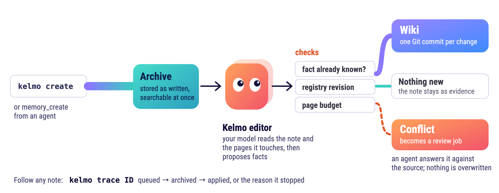

# Note reconciliation contract

<p align="center">
  <picture>
    <source media="(prefers-color-scheme: dark)" srcset="assets/kelmo-note-path-dark.png">
    
  </picture>
</p>

## Plain-text notes

Use `kelmo create --project NAME --text TEXT` or `--file note.md` for new notes.
The command selects the registered project map by default; repeat `--target` to
select other registered pages. The worker archives the exact input, then calls
the scoped editor. The executor can request current reconciliation receipts
during that operation. Publication still checks revisions, ownership and source
evidence. No model can turn a stale receipt into permission to overwrite a fact.

Reconciliation, page listing, exact page facts and the bounded context view
read a committed knowledge generation. Unpublished registry
edits do not become current facts or break those reads. A missing or corrupt
generation is an error; these commands do not fall back to uncommitted state.

These read commands work through a shared-client profile as well:
`kelmo pages --project NAME`, `kelmo page TARGET`, and
`kelmo context --project NAME --budget-tokens LIMIT --select TARGET`.
The server uses the same read methods as a local vault. They neither queue writes
nor fall back to cached context; an unavailable server or older server lacking
the operation returns an explicit error.

The same request key binds the source bytes, project and selected pages. A retry
after interrupted publication reuses the editor result. If no executor is
configured, the source remains archived and pending; the trace names the missing
step. `--rule-change` requires a requester-capable enrolled origin. Ordinary notes
cannot silently rewrite protected rules.

Open work (status `backlog` or `in-progress`) lives only on a work page. When no
work page exists for it, the editor opens one: the model answers
`{"open_work": {"slug", "title", "summary", "priority"}}` (priority H1, H2 or H3
when the source states one; it becomes the page priority shown on the hub row), the publisher allocates
`<project directory>/SLUG.md` (`projects/P/SLUG.md`, or `life/SLUG.md` for the
top-level `life` project) under the project map, or under the project's own
index page (`P/P.md`) when it has no map, moving past a taken slug with a `-2`
to `-99` suffix, and sends the page back as `new_work` in the next round. A source
the model declines outright gets a page named after its file when that name makes a valid slug and the project has a map or index page (`my-note.md` opens
`my-note`, titled `My note`) and one more round; declined again, it settles as
evidence only (`archive-only`, with the model's reason), never as a failure. The
caller may still name the page itself:
`kelmo create --project P --new-work SLUG --title TITLE [--summary TEXT] [--priority H1|H2|H3]`
(MCP: `memory_create(..., new_work={"slug", "title", "summary", "priority"})`); without
`--priority`, a `priority:` line in the note's frontmatter sets it. That request is
refused before capture when the target or page ID is registered, or when any file
already exists there (an unregistered page is never claimed). Either way the page
is created in the same publication as the facts the editor places on it, with the
given title and summary; a note whose facts land elsewhere creates no page.

A refused editor attempt (a malformed proposal, a wrong receipt, a stale
generation, an executor that returned no usable answer) is never final by
itself: the source parks (state `parked`, outcome `unresolved` with the
refusal), and the next `kelmo dream apply` pass consults the model again with
that refusal as its first hint. The third charged refusal fails the source (a stale-generation `E_STALE` refusal is retried uncharged up to five times) and
alerts the vault owner through `[alerts]`, since a note the model could not
place three times needs a person. Infrastructure waits (quota, a lost login, a
busy claim) are never charged as attempts.

`[editor] mode = "nightly"` holds every archived note for the Dreaming pass:
the worker archives it and records `awaiting_dreaming`; `kelmo dream apply`
(or `dream run`, which applies first) publishes it. The default `immediate`
mode publishes as soon as the note is archived. `--pending LINE` (MCP
`pending`, at most 240 characters) is the one line agents see at startup, under
"Pending wiki updates", while the note waits; it disappears once the note is
applied. A note whose text carries two frontmatter blocks in a row has them
merged at capture; a note that is frontmatter alone is refused at capture.

An existing wiki file that no registry entry names is registered explicitly,
without a model: `kelmo register PAGE... [--kind topic|work --summary TEXT]`
shows the entries, `--apply` publishes them. The page ID is its path
(`projects/P/x.md` becomes `projects-P-x`), the title is the file's own
(frontmatter `title`, else its first H1), and the page keeps the legacy layout:
every byte and its hand-written header stay, publication only appends the
managed kb region, and nothing links to or from it yet. A topic page holds
settled facts; a work page (with a summary) also holds open work. Registration
runs under the worker lock after every prepared publication finishes, claims
only committed, unedited files, never a person page, and reports a target that
is already registered instead of registering it twice. After it, notes select
the page with `--target` like any other.

Shared clients submit through their durable outbox. `--wait` observes the server
worker and `--wait-timeout` bounds that observation. MCP `memory_create` returns a
capture receipt; use `memory_trace` to determine whether publication completed.
The server settles a refused note under its key, so sending the same entry
again only replays the refusal. Once the cause is fixed (a newer server, a page
registered with `kelmo register`), `kelmo client resend` lists the refused
`create` entries whose code matches `--code` (repeatable, default `E_INPUT`);
with `--apply` it queues each one again under a new key (`<key>#resendN`),
marks the old entry `resent` with the new key, and flushes. Each run that
applies takes the next free suffix, so a note refused again can be resent
once more after the next fix. A text goes out once: a refusal whose text a
queued or delivered note already carries names that note instead
(`duplicate: true`), and of several refusals with one text only the newest is
sent.
The editor sends the archived source, its reconciliation receipts and every
mandatory person page whole, then the selected pages and the pages the model
asks for (each as its facts, narratives and actions plus its hand-written
text), within one context budget. Pages linked to the selected ones wait in
the project index until the model asks for them.
A caller that names no budget (`kelmo create` without `--budget-tokens`, every
shared client, the MCP `memory_create` tool) receives the vault's `[editor]`
`budget_tokens`, or 24000 estimated tokens when the table is absent. A vault
whose mandatory pages alone approach that figure sets the table once:

```toml
[editor]
budget_tokens = 200000
```

An explicit `--budget-tokens` still wins for that call. A budget that cannot hold
the source, receipts and mandatory pages fails the operation with `E_BUDGET`
before anything is sent to the model; nothing is labelled complete. A request
whose selected pages do not fit also ends in `E_BUDGET` before the model is
called, and the refusal names the omitted pages with what each needed and what
was left. A reconcile round that would crowd out a sent page runs no search:
the model gets a repair instead.

Sources already archived and waiting for an executor or a recorded quota reset
do not consume the worker's processing batch. Independent scheduled archive work
can continue behind them. The waiting sources remain durable and resume when
their executor becomes available; the worker does not call a deferred provider
early or treat a capture-only source as scheduled work.

## Structured import compatibility

Archive-only capture accepts Markdown without fact declarations. Promotion requires
both wiki-changes and fact-checks fenced JSON arrays. Each proposed fact has exactly
one check. This applies to direct Service callers as well as the CLI. Older pending
promotions without checks fail visibly; there is no automatic verification backfill.

For a new fact, run:

```sh
kelmo reconcile --vault /path/to/vault --text 'The project uses SQLite.' --target projects/example.md --json
```

Read the candidates before declaring not_found. The command searches current wiki
facts using lexical overlap and page preference, returns at most 20 candidates,
and exposes total_facts and truncated. It does not perform semantic deduplication.
The receipt persists in the vault journal and binds the exact text and target to
the current candidate revisions. It proves the operation ran, not that
the agent read the result or that no equivalent fact exists.

Insert the returned search_id into this note (the example ID is not a valid receipt):

````markdown
```wiki-changes
[
  {"fact_key":"example.database","target":"projects/example.md",
   "text":"The project uses SQLite.","status":"active",
   "expected_revision":null,"replaces":[]}
]
```

```fact-checks
[
  {"fact_key":"example.database",
   "verified_match":{"result":"not_found","search_id":"COPY_RETURNED_SEARCH_ID"}}
]
```
````

For an existing fact, use verified_match with result=existing, its fact_key and
revision. Use that same identity in wiki-changes and put the revision in
expected_revision. A different key is not an update. Both confirmations and
updates use this reference form. Replacement/merge adjudication is not implemented.

The CLI validates checks before capturing a new promotion; the worker validates
again before application. A changed candidate set invalidates new-fact search
receipts. Reconcile again instead of guessing a revision.
An already committed note can finish journal recovery without repeating its write.
Receipt validation is a consistency check, not an OS security boundary.

A rejected change or check names the fact it belongs to and the repair that is
permitted: the fact text length and the page for a change that is otherwise well
formed, the revision the check claims against the one the registry holds, and the
`kelmo reconcile` run to rerun when a search receipt no longer matches. A value
that fails its own shape check is not echoed back.

## Install agent guidance

```sh
kelmo install --instructions /path/to/CLAUDE.md --disable-native-memory --json
kelmo install --instructions /path/to/AGENTS.md --allow-native-memory --json
```

Choose a policy explicitly; disable-native-memory is the recommended instruction
policy. This command installs guidance only, not the runtime, model, daemon or MCP
registration. Native memory is prohibited by text when selected, not disabled in
client settings. Existing native memories are untouched. The result reports both
states separately. Reruns replace our marked block and preserve surrounding bytes;
changed existing files receive a verified byte-identical backup. Symlinks and
ambiguous block markers are refused. The instruction text is model-neutral; its
behavior has not been evaluated against live agent models.

## Page enrollment

Shared creation, promotion and resolution pass the server profile's trusted
`ContextBindings` to the scoped editor. An enrolled feature can therefore gain
its declared detail page through the same publication path. Requests cannot
supply or replace those bindings. A local library integration may inject
`Service(..., context_bindings=...)` only with the same trusted origin bindings;
without that enrollment, existing page-creation refusals remain.
