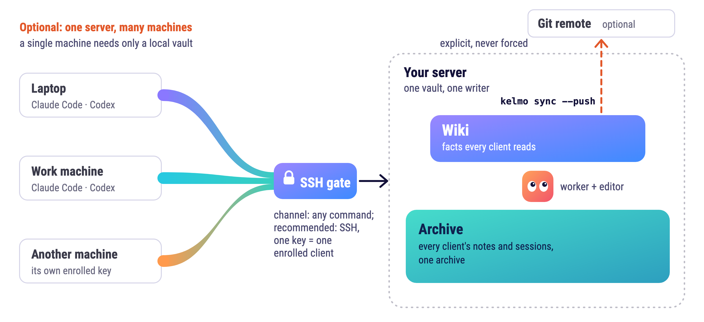

# Shared server enrollment

<p align="center">
  <picture>
    <source media="(prefers-color-scheme: dark)" srcset="assets/kelmo-server-dark.png">
    
  </picture>
</p>

Run these commands on the server that owns the vault. They are local controller
operations and are not exposed through the client protocol or MCP. Mutating
commands preview by default; add `--apply` to write. Changed profiles receive
verified backups. No command starts a service or creates an SSH connection.

```sh
kelmo --vault /srv/memory server init --profile /srv/config/server.json --apply
kelmo --vault /srv/memory server enroll --profile /srv/config/server.json --client-id laptop --machine-tag laptop --apply
kelmo --vault /srv/memory server status --profile /srv/config/server.json --json
```

Initialization uses the archive's existing writer identity. It never guesses a
new writer name for an imported archive. New profiles start fenced and use the
confined archive process. Install its OS prerequisites before starting the shared
service. Client channels share one daemon: `serve-client` starts the vault's
`kelmod` if none runs and attaches to it, so every connected client talks to
one state core. Each client channel and job starts its own archive process; one that gets
no request for five minutes exits on its own, and the next request starts a new
one, so an idle session holds no archive connection or tokenizer. Client enrollment does not grant requester-attestation authority unless
`--requester` is supplied explicitly.

Enroll repository bindings before assigning them to a client:

```sh
kelmo --vault /srv/memory server repository --profile /srv/config/server.json --repository-id example --root /srv/repositories/example --remote https://example.org/team/example.git --project example --apply
kelmo --vault /srv/memory server enroll --profile /srv/config/server.json --client-id project-laptop --machine-tag laptop --repository-id example --apply
```

A conflicting existing identity is refused. These commands add enrollments;
changing an existing grant requires an explicit reviewed profile edit.

## Writer changes and recovery

Stop the old worker and close its client channels before changing service
ownership. Back up the current vault. Rotate the writer with the expected current
epoch and a fresh receipt:

```sh
kelmo --vault /srv/memory server rotate-writer --profile /srv/config/server.json --writer-id primary --expect-epoch 1 --receipt /srv/recovery/writer-2.json --apply
```

Rotation records its intent first, then advances the archive epoch under the
existing worker lock and a database transaction, and finally updates the profile.
An old writer is rejected by the archive after the epoch advances. If the profile
write fails, repeat the same command with the same receipt to finish forward.
The receipt accepts only its recorded old or new writer; later rotations and
unrelated profile edits are refused. Never lower the epoch to restore a backup.
The operation changes writer metadata, not stored records or their versions.

Set the desired fence before restarting the channels and worker:

```sh
kelmo --vault /srv/memory server fence --profile /srv/config/server.json --off --apply
```

Profiles are loaded at process startup. A fence edit alone does not change running
processes or revoke an already opened writer. To stop writes, stop those
processes; use an epoch advance when an old writer must be rejected. Restart
with `--server-profile /srv/config/server.json` on background worker commands.
After restart, use `client status --probe` from an enrolled client to verify the
authority, client identity, current epoch and fence. This does not flush its outbox.
