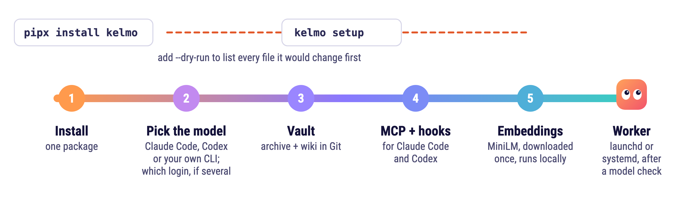

# User installation

<p align="center">
  <picture>
    <source media="(prefers-color-scheme: dark)" srcset="assets/kelmo-install-dark.png">
    
  </picture>
</p>

Use Python 3.12 or 3.13 on macOS or Linux. Configure Git author name and email,
install the chosen agent CLI and authenticate it using that client's login flow.
The installer does not copy credentials. Run from this repository:

```sh
python3 install.py --dry-run --disable-native-memory --provider codex --model YOUR_MODEL
python3 install.py --disable-native-memory --provider codex --model YOUR_MODEL
```

On Linux, install the distribution's bubblewrap package at `/usr/bin/bwrap`.
If that is unavailable, supply a reviewed executable with
`--bwrap-source /absolute/bwrap --bwrap-sha256 EXPECTED_SHA256`. The installer
copies it to its private runtime's `lib/pythonX.Y/libexec/bwrap`, reports the
path and backs up a replaced copy. It never fetches this executable or runs
privileged commands. Dry-run validates the hash without creating the runtime.
The Linux isolation policy currently supports x86_64 only. A present launcher
does not prove that the host permits user namespaces: run the documented native
kernel-boundary check before activating a server.

`kelmo doctor` reports `git_identity` as a check and the sandbox launcher under
`runtime_isolation`: a local vault runs without it, a shared server's archive process needs it.
For a systemd user worker that must survive logout, an administrator enables
linger for the service account with `loginctl enable-linger ACCOUNT`.

Add `--project example` to name the first project (default: `default`). A new
vault starts with the current registry and its registered project map, ready for
`kelmo create --project example --text 'A durable decision.'`. Initialization
never takes over existing data: an existing vault keeps its content, and a
registry in an older format is refused with `E_CAPABILITY`. To bring existing
knowledge into Kelmo, start an empty vault and add it through `kelmo create`.

`--git-name 'Your Name' --git-email 'you@example.org'` sets the new vault's local
Git identity without changing global Git configuration. Omit both to use the
account's configured identity. The same flags are available on `kelmo init`.
Reinitializing an existing shared vault reads its configuration without trying
to reclaim the archive as a local writer.
If first initialization is interrupted, rerun it with the same `--project`.
A saved initialization receipt resumes the project setup and recognizes an
already published project after a crash. Existing stores without that receipt
remain unchanged.

For a server without local agent integrations, use `--client none`. Add
`--server-profile /absolute/server.json` when preparing the service for an
existing shared authority. The profile must already match that vault; a fenced
profile requires `--no-start`. See [server operations](SERVER-OPERATIONS.md)
for enrollment and the explicit cutover sequence.

`--embedding-profile /absolute/embedding.json` selects a complete local or broker
profile without downloading the default model. Existing selected providers are
retained on reinstall. Alternatively, `--skip-model` skips model provisioning
and permits installation with lexical search, reported as degraded until a model
is available. These options and `--model-source` are mutually exclusive.
`--effort low|medium|high|xhigh|max` configures the selected native executor;
Codex does not accept `max`. Custom adapters own their effort policy.

For example, prepare a new local server without downloads, client changes or
service activation:

```sh
python3 install.py --vault /srv/memory --project example --client none --allow-native-memory --skip-model --no-start --git-name 'Memory Service' --git-email 'memory@example.org'
```

The first command previews the installation. It uses the same client preflight as
setup, lists exact file paths and create/update/unchanged actions, and identifies
files that would receive backups. It creates no runtime, vault, client files,
locks or backups and makes no downloads, provider calls or service-manager calls.
It works before package dependencies are installed. Existing configuration values
are not included in its output. The installed equivalent is `kelmo setup --dry-run`
with the same options and an explicit `--executable`.

A successful preview is not an installation readiness verdict. Model integrity,
archive/wiki health, wiki ownership, executor readiness and native host acceptance
remain apply-time or host checks and are listed separately. Missing provider CLIs
are reported in the plan. Remove `--dry-run` to apply; selected agent clients need
a restart and may require native hook trust approval.

Use `--provider claude` for Claude Code. The model is explicit; there is no model
fallback. `--executor-config PATH` accepts a custom command adapter instead. A
custom adapter must answer {"task":"probe"} with {"ok":true}. The built-in adapters
perform a real model request during readiness checking, which can use subscription
capacity or incur provider charges according to the user's configured client.
Claude readiness uses its CLI's structured-output schema for the boolean probe.
Resolution replies still pass the normal schema and revision checks.

A custom provider can be selected directly, without writing an executor
configuration first:

```sh
python3 install.py --disable-native-memory --provider custom --provider-executable /absolute/router
```

For an interpreter plus arguments, use `--provider-command-json
'["/absolute/python", "/absolute/router.py"]'` instead of
`--provider-executable`. Custom routers can choose their model themselves;
`--model` is optional for them. The same options work with `kelmo setup`.
Native providers also accept `--provider-executable` to pin their CLI.
The custom process uses the protocol in [EXECUTORS.md](EXECUTORS.md); setup
performs its normal readiness probe before enabling the worker.

## Shared clients

Install a client of an existing server with one command:

```sh
python3 install.py --disable-native-memory --vault /path/to/client --shared-authority SERVER_UUID --shared-command-json '["/usr/bin/ssh","server-alias","kelmo-client","laptop"]' --dry-run
```

Remove `--dry-run` to install the runtime and client integrations. The server's
authority must already exist and the channel must identify an enrolled client.
The installer writes a client profile, MCP configuration and hooks with verified
backups. It does not create a local archive or wiki, download an embedding model,
call a provider, or start a second worker. Those belong to the server.

An existing `client.toml` is detected automatically on reinstall. Setup preserves
its authority and channel; changing either requires an explicit connection
migration. `--session-memory archive-only` enrolls the selected local transcript
roots and installs session capture hooks. Omit it to install SessionStart only.
The result reports that the connection has not been verified; restart the agent
and probe the connection before treating the remote service as available.

For an already installed runtime, use `kelmo setup --vault /path/to/client
--executable /absolute/prefix/bin/kelmo --disable-native-memory` with the same
shared options. Dry-run mode validates without writing even when called as the
preflight of a real installation.

The installer creates a private venv, installs this package with pinned dependency
constraints, and invokes `kelmo setup`. It fetches the pinned model files with
size and SHA-256 verification, or uses `--model-source PATH`. Network access is
needed for dependency installation and model fetching. `--prefix` selects the
runtime; an unmanaged nonempty directory is refused. `--vault` selects the data.
`--home` selects client configuration placement and user service files.

Before upgrading an owned runtime, stop the processes using it. The installer
copies it into a private adjacent `runtime.backup-*` directory and verifies
file bytes, modes and symlink targets before changing the interpreter/packages.
The backup path is reported on stderr and retained on failure. Symlink targets
are recorded, never copied from outside the runtime.

To restore code, stop the new processes, retain the failed runtime separately,
and put the saved `runtime` directory back at the exact original prefix from
its manifest: launcher shebangs contain that path. Verify the manifest before
restoring. Runtime restoration does not restore vault data or discard writes
accepted after an upgrade; use the migration recovery procedure for data.

Use `--wiki /path/to/knowledge` to keep knowledge in its own Git repository,
separate from the service data: that directory becomes the knowledge repository,
with pages under `knowledge/wiki` and the fact registry under
`knowledge/provenance`, the same layout a shared server binds. The directory
must be empty (an empty Git repository is fine); one that already holds files is
refused with `E_WIKI_ENROLL`. The journal and the archive remain
under `--vault`. Omitting `--wiki` retains the default embedded layout for a new
vault and the configured location on reinstall. An explicit different path is
rejected for an initialized vault.

Setup initializes the vault if necessary, imports the model, checks memory health,
probes the executor, writes the selected clients' integrations and starts the user
service. `--client claude|codex|both` selects profiles. `--allow-native-memory` omits
the prohibition rule. The native-memory option must be explicit.

Reinstalling on Linux reloads the unit files, enables the worker and restarts it
so an existing process uses the new service definition. Restart also starts an
inactive worker. `--no-start` leaves the running service alone. A failed activation
stops setup and retains the prepared configuration for recovery.

Installed agent guidance uses the absolute runtime executable and selected vault,
so it works when the private runtime is absent from PATH and the data is outside
the default directory. Setup also returns the executable and a
PATH hint for interactive use; it does not rewrite shell startup files. A later
standalone instruction install preserves the existing command binding.

Claude integration uses ~/.claude.json for MCP and ~/.claude/settings.json for
hooks. Codex uses ~/.codex/config.toml, enables the hooks feature and writes
~/.codex/hooks.json. Instruction blocks go into each client's global instruction
file. Restart clients and approve hook trust if requested by the installed version;
the installer never bypasses hook trust. Existing unrelated configuration is kept
and changed files receive backups. Symlinked managed paths are refused.
Use `--claude-profile /absolute/.claude-second` or
`--codex-profile /absolute/.codex-other` for separate accounts. An explicit Claude
profile keeps its MCP config at `PROFILE/.claude.json`; `--claude-mcp-config`
can name a different file. Hooks, instructions and ownership stay under the
selected profile. Session capture uses that profile's transcript directory.
Repeat setup for another profile; unselected profiles are untouched. Uninstall
accepts the same path options.

New MCP registrations use `mcp --reconnect`. Setup recognizes a matching
registration made by `client migrate-mcp` and records ownership when installing
hooks and instructions. It still refuses an unrelated registration using the
same name. Removal recognizes both the previous plain MCP command and the
reconnecting command.
The result lists backup paths. A partial failure identifies the completed client
steps so rerunning setup can resume without replacing unrelated configuration.
Both client profiles retain current and previous owned MCP entries in
`kelmo/ownership.json`. Repeating the same interrupted update can recognize
older hooks. Existing marked Codex configurations without a receipt remain
eligible for upgrade; edited receipted entries require manual resolution.

Setup validates the selected client files before installing instructions. It
refuses conflicting unmanaged MCP entries and checks that Codex TOML changes only
the requested MCP integration and hooks feature. Unsupported or ambiguous TOML
shapes are rejected. Writes compare the bytes originally read, so a concurrent
configuration replacement is retained. This check spans each file separately;
a later conflict can leave earlier installation files updated.

Configure explicit global/project pages as described in [HOT.md](HOT.md).
SessionStart supplies those complete pages within the byte ceiling; without HOT
configuration it supplies no wiki context. Automatic capture is opt-in through
`--session-memory auto|archive-only|off`; see [session memory](SESSIONS.md) for the
complete-note archive, optional wiki promotion and recovery behavior. Enabled
session hooks replace the legacy last-assistant-message collector. Manual collector
evidence still requires explicit promotion through the CLI or MCP tools.

macOS uses a launchd user agent; Linux uses a systemd user service. The latter
requires a working user manager. Logout persistence on Linux depends on the host's
user-service policy. `--no-start` prepares files without starting a service and
reports complete=false. Omitting an executor leaves memory usable and resolutions
pending; executor_ready and complete remain false.

The command prints separate memory, executor and background readiness. Successful
service activation means the service manager accepted the start request, not that
every future tick is proven. A failure leaves prepared files and verified backups
for inspection; this is not a transactional rollback installer. Consult status and
trace for processing failures. No existing deployment is replaced by setup.

## Verification limits

Temporary-profile tests cover repeat configuration, native-memory option changes,
MCP service operations, hook capture, model provisioning with synthetic assets,
and launchd/systemd generation. Native CLI adapters were tested using synthetic
subprocesses matching their response formats. A live Claude readiness probe also
passed through the installed adapter. Closed-vault relocation is covered by
local source and installed-package tests. OS isolation is not supplied by this profile.

Native acceptance ran in November 2026 from a built wheel. On macOS in a temporary profile,
Claude Code 2.1.319 received its context at session start, on the next prompt after a publication and
after `/compact`, and followed a project rename and unlink. Codex CLI 0.167.0, once its hooks were
trusted, received it on the first prompt, on the next prompt after a publication and after `/compact`. On a
fresh Debian trixie arm64 container with systemd, Claude Code 2.1.317 received it at session
start and on the next prompt. Delivery changes made after that run are covered by the
test suite only. Codex on Linux, x86_64 Linux with bubblewrap, installing from PyPI, other client
versions and restoring a running service across platforms were not part of it.

Temporary-profile coverage also includes restoring all eight client files from
one upgrade's backups, retaining intervening user edits, and reinstalling again.
This exercises file recovery, not a running-service rollback. Client integrations
can be removed with preview and exact ownership checks; see [REMOVAL.md](REMOVAL.md).
The removal command retains the runtime, background worker and durable data.
