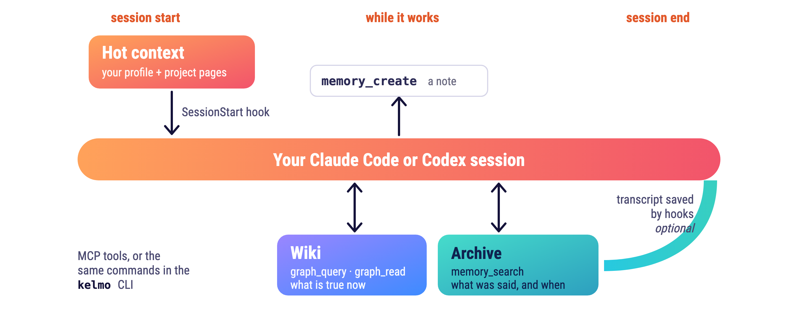

# Using Kelmo

<p align="center">
  <picture>
    <source media="(prefers-color-scheme: dark)" srcset="assets/kelmo-agent-view-dark.png">
    
  </picture>
</p>

This guide collects the everyday commands, how to measure a call, how to serve a vault for a whole session, and the budget checks `kelmo doctor` runs. The README has the short version.

## Everyday commands

One local path: initialize a vault, queue a source, archive it, apply accepted
facts, and inspect its status and trace.

Write a note with:

```sh
kelmo create --project example --text 'Exports now run nightly at 02:00.' --json
```

The original text is archived unchanged. The worker asks the configured executor
to update the project's registered map and relevant pages through the scoped
editor. Use `--target projects/example/exports.md` to select a page explicitly,
or `--file note.md` to supply a longer source. No fact blocks are required.
`kelmo trace OPERATION_ID` reports publication separately from capture. Without
an executor, the archived source waits for configuration. A vault whose
`[editor] mode` is `nightly` holds each note (event `awaiting_dreaming`) until
the next `kelmo dream apply` or `dream run` pass; see [Dreaming](DREAMING.md). MCP exposes the same
path as `memory_create`. A wiki file that exists but is not registered is
refused as a target; `kelmo register projects/example/exports.md --apply` adds
it as a legacy page first. See [the note contract](NOTE-CONTRACT.md).

An enrolled shared client can apply an explicit work-state statement with
`kelmo action apply` or MCP `memory_apply_action`. It requires exact archived
evidence and server-granted authority. See [action updates](ACTIONS.md).

This release uses the installation's Python 3.12/3.13 without requiring
bubblewrap, Seatbelt or a dedicated OS account. Python `-I -S` avoids ambient
Python startup hooks; it does not restrict files or network access. The process
has the user's permissions. Embedding models must still be provisioned locally.
The earlier isolation experiments remain in [RUNTIME-SECURITY.md](RUNTIME-SECURITY.md)
and the runtime modules. They are not security guarantees of the default launcher.

Initialize a selected empty vault with `kelmo init --vault /path/to/vault --label laptop`.
`kelmo init` with no `--vault` at a terminal asks for one and offers the vault
`KELMO_VAULT` names when that variable is set, so Enter keeps the vault a client
configuration already chose instead of building a second one under the default directory.
Provision the pinned model from an existing local cache or flat artifact directory
with `kelmo models import --vault /path/to/vault --from /path/to/model-cache`.
The import verifies the five required files before publishing model storage.
The default profile does not provide an OS permission boundary around that storage.
`kelmo models list` discovers available names; `kelmo models use` selects a
verified local directory or a prepared broker profile with a configuration backup.
See [embedding model selection](MODELS.md).

If query embeddings are unavailable, `kelmo search` still searches archived text
using FTS5. CLI and MCP results report `search.mode`, `search.degraded` and
`search.reason`, including when no records match. This fallback cannot find
semantic paraphrases without shared words. Ordinary archive intake preserves text,
FTS and its operation receipt when embeddings are unavailable, marking vectors pending.
`--supersedes` requires successful indexing before it hides the old record.

Take one record out of circulation with `kelmo forget ARCHIVE_ID --vault /path/to/vault`.
A forgotten record leaves `kelmo search` and `kelmo list`, `kelmo show` refuses it
with `E_FORGOTTEN`, and the operation that archived it gains a `forgotten` stage while
the archived bytes stay in the vault. Physical removal requires the separate
administrator purge plan and apply flow described in [CLI.md](CLI.md).
`forget` is a CLI action and has no native MCP tool.

Correct a record instead of storing a second claim beside it with
`kelmo add --file note.md --supersedes ARCHIVE_ID --vault /path/to/vault`. When the
new record is archived, the old one is forgotten with the reason `superseded by <id>`,
so search returns only the correction; `kelmo show` names the link in both directions
(`supersedes`, `superseded_by`) and `kelmo status` counts `superseded_records`. Nothing
is forgotten while the replacement is still queued or has failed.

With a shared client, `add --wait` and `promote --wait` observe the server worker.
They do not queue a second processing request. `--wait-timeout SECONDS` limits
the wait (default 300); a timeout reports `processing_deferred` and the operation
ID while leaving accepted work on the server. Use `kelmo trace ID` to check it.
An offline capture stays in the local outbox until the next successful flush.
Local vaults still process directly when `--wait` is supplied.

Three optional MCP arguments fold a follow-up call into the first one. The tool
count stays fifteen. `memory_create(wait=N)` follows the operation for up to N
seconds (at most 600) and returns its final stage with the last event. A
deadline answers `wait_timed_out` and a lost channel answers `wait_error`; both
leave the accepted write as it is and name the `memory_trace` call that shows
the rest. `memory_search(expand=N)` adds `expanded`: for the top N records (at
most 5) the hit chunk with one neighbour on each side, or a record without
chunks read whole, cut at 6000 characters and marked `truncated`.
`graph_query(action="search", read=true)` adds `page`, the first result read
with `graph_read`.

Scope a search with exact filters: `--project NAME` (the source's frontmatter `project`),
`--tag TAG` (repeatable, every tag must hold; frontmatter `tags: [a, b]` are stored with
the record), `--since DATE` and `--until DATE` (the record's fact date: an explicit `valid_from` or
the date in the source filename, else the storage moment; `--until` includes its whole day). Filters only narrow a result, apply in
lexical fallback too, and are echoed in `search.filters`. MCP `memory_search` takes
`project`, `tags`, `since` and `until`. Dates are plain days (`2026-10-10`); a time or an
offset is refused. The frontmatter is read in one-line form only: `project: name` without
quotes and a flow list `tags: [a, b]`; a block list or a quoted value is not stored, so
that record is outside every scoped search. Records stored before this release carry no
frontmatter tags. A correction of a record that is already superseded or forgotten is
refused with the current head of its chain named.

Navigate current wiki pages without an embedding model:

```sh
kelmo graph query search --query "setup" --vault /path/to/vault --json
kelmo graph query neighbors --id projects/example/setup --vault /path/to/vault --json
kelmo graph read projects/example/setup --vault /path/to/vault --json
kelmo graph stats --vault /path/to/vault --json
```

Queries refresh the selected wiki's derived index when its contents change.
Page IDs preserve their relative paths and Unicode; ambiguous short names return
candidates. The same graph operations are available through MCP. See
[graph navigation](GRAPH.md) for freshness, limits and failure behavior.

Before clearing a session, `kelmo sessions review` reports unfinished processing.
Supply the provider, session ID and enrolled transcript path to check current bytes
against the preserved snapshot; see [session memory](SESSIONS.md). Preserved
bytes and completed jobs do not establish that every meaningful fact was extracted.

## Measuring a call, and serving a vault for a whole session

With the installed launcher, a command is a small client of the vault's `kelmod` daemon
(see [architecture](ARCHITECTURE.md)): the vault is opened and the model loaded there, not
in the command. A source checkout, or a launcher without `kelmod` beside it, runs every
command as a fresh process. `--timings`, in front of the command name or after it, writes
exactly one JSON line to stderr after the answer, so a caller that reads stdout sees the
same bytes it always did. A fresh process reports:

```sh
kelmo --timings search "gate runner" --vault /path/to/vault --limit 5 --json
{"schema_version":1,"timings":{"command":"search","parse_ms":0.3,"engine_import_ms":74.1,
 "operation_ms":548.9,"model_load_ms":152.4,"process_ms":556.2}}
```

`KELMO_TIMINGS=1` turns the same line on for every call of a session, which is what a
wrapper measures with. `process_ms` counts from the first line of this package's own code to
the moment the answer was written; a launcher's shell and the interpreter's startup run
before it, so time the whole process and subtract `process_ms` to see them. `operation_ms`
is the service work, and `engine_import_ms` and `model_load_ms` are parts of it. A stage that
did not happen is absent, and `model_load_ms` is named only by the call that paid for the
load. A call through the daemon names neither of those two stages, and its `operation_ms`
includes the round trip to the daemon.

Without the daemon, `kelmo mcp --vault /path/to/vault` is the way to pay that load once: it
serves the same tools over stdio, opens the vault once per worker thread, loads the pinned
model before the first request and says so once on stderr. Setup registers it for a source
checkout and on a server; with the installed launcher it registers the daemon's HTTP
endpoint instead.

```sh
kelmo mcp --vault /path/to/vault
kelmo: model loaded in 348.6 ms for vault /path/to/vault
```

A server whose model is absent says that instead of refusing to start, and keeps the lexical
fallback documented above. A write made through a tool is visible to the next call without a
restart. With `KELMO_TIMINGS=1` the server adds one timings line per call, naming no
model load because it paid for that at start. `kelmo --vault` still wins over
`KELMO_VAULT`, which exists so a client configuration can name the vault once instead
of on every call.

## Budget checks

`kelmo doctor` measures two things that can outgrow a limit: the hub pages of the wiki
this package manages, and the instruction files a coding agent loads at the start of a
session. Which instruction files those are belongs to the user's own agent, so they come
from the vault's `kelmo.toml` and nothing is assumed about the layout:

```toml
[budget]
token_limit = 60000

[[budget.chain]]
name = "claude"
root = "~/.claude"
global = ["CLAUDE.md"]
projects = ["projects/*/CLAUDE.md"]

[budget.anchors]
"~/.my-agent/" = "~/src/my-agent"
```

Each `[[budget.chain]]` names one directory that holds instruction files: `global` lists
the files loaded for every project, `projects` lists glob patterns relative to that root,
one path segment per level. A chain is measured once on its own and once beside each
project file it loads, and the estimate is UTF-8 bytes / 2.5 with comments included; a
chain over `token_limit` is reported as `HOT budget exceeded: <name>` and the same limit
refuses a wiki commit with `E_BUDGET`. `@path` import lines inside those files resolve
against the directory each prefix in the vault's `[budget.anchors]` names (no prefix is
built in); anything else is an absolute path, a `~` path, or a path
relative to the importing file.

A vault that configures no `[budget]` table measures no instruction chain, and says so:
`doctor` reports `hot_chains_configured: 0` beside `hot_chains_checked: 0` rather than a
pass. A configured chain whose `global` file is absent is named in `hot_chains_uncovered`
and repeated as a warning instead of being skipped silently. An `@` import whose page the
vault does not hold is named the same way (`hot_imports_unresolved` carries
`<chain> -> <path>` and `doctor` repeats it as a warning), and the chain is still measured,
with the import line counted as written: a page a fresh vault has not been given is not a
budget violation. An import cycle or a file that cannot be read is a violation, named as
`anchor resolution failed: <chain> (<error>)`. Each chain `doctor` measured is reported in
`budget_chains` with its `estimated_tokens` and the imports it could not resolve, so a
`token_limit` is chosen against what the vault actually loads rather than guessed. A malformed
`[budget]` table stops the vault from loading.
